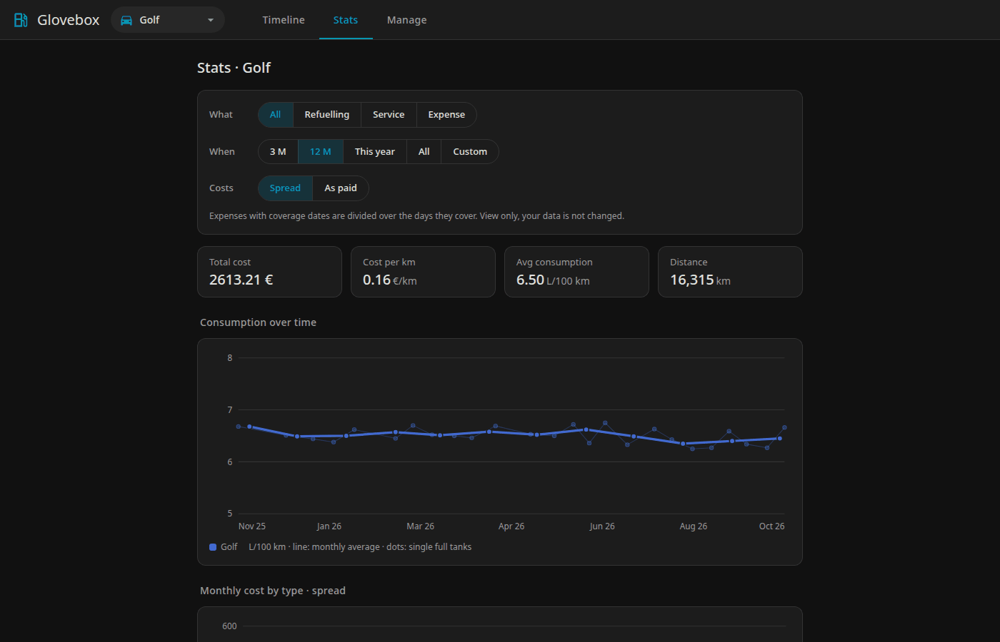
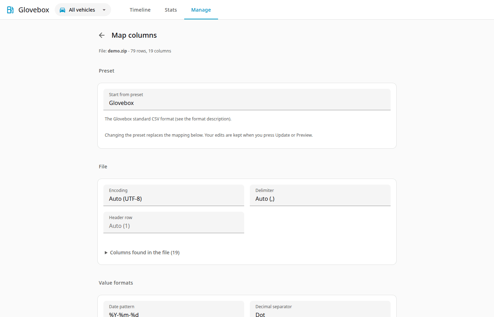

<p align="center"></p>

# Glovebox

**Self-hosted tracker for what your cars cost to run: fuel, service, insurance and registration, with statistics.**

[](https://github.com/domengorjup/glovebox/actions/workflows/tests.yml)
[](https://github.com/domengorjup/glovebox/actions/workflows/docs.yml)
[](LICENSE)
[](https://github.com/domengorjup/glovebox/tags)

<p align="center"><a href="https://domengorjup.github.io/glovebox/"></a></p>


*Costs, consumption and every entry at a glance.*


*Consumption and costs over time, in HA's dark theme.*


*Map any CSV once, then save it as a preset.*

## Features

- Refuelling, service and other expenses (insurance, registration, parking) for any number of vehicles.
- Statistics: consumption between full tanks, cost per km, monthly costs, price comparison by gas station and brand.
- Configurable CSV import: a column mapping step with presets (Fuelly, Fuelio, Drivvo, your own), a preview before anything is written, and undo per import.
- A documented standard CSV format, a Fuelly-compatible export and a full backup ZIP.
- Looks like Home Assistant and follows its light and dark theme; opens in the sidebar through Ingress, no separate login.
- Read-only stats API for Home Assistant sensors.
- Runs as a Home Assistant add-on or as a standalone Docker container; the data is one SQLite file.

## Install as a Home Assistant add-on

[](https://my.home-assistant.io/redirect/supervisor_add_addon_repository/?repository_url=https%3A%2F%2Fgithub.com%2Fdomengorjup%2Fglovebox)

Press the button, or add the repository by hand: **Settings > Add-ons > Add-on store > menu (three dots) > Repositories**, paste `https://github.com/domengorjup/glovebox` and click **Add**. In Home Assistant 2026.6 and later add-ons are called apps: **Settings > Apps > Install app > menu > Repositories**.

Then install **Glovebox** (the image is built on your Home Assistant host, so the first install takes a few minutes), start it and enable **Show in sidebar**.

Options and details: [addon/glovebox/DOCS.md](addon/glovebox/DOCS.md).

## Run standalone

```sh
docker build -t glovebox .
docker run -d --name glovebox -p 8080:8080 -v ./data:/data glovebox
```

Open `http://localhost:8080/`. The container runs as UID 1000, so the data folder must be writable by it. Either `chown 1000 ./data` or add `--user "$(id -u):$(id -g)"`. On SELinux hosts (Fedora) append `:Z` to the volume option.

### Environment variables

| Variable | Default | Meaning |
|---|---|---|
| `GLOVEBOX_MODE` | `standalone` | `standalone` or `addon` (behind HA Ingress, no login) |
| `GLOVEBOX_HOST` | `0.0.0.0` | Bind address |
| `GLOVEBOX_PORT` | `8080` (`8099` in addon mode) | Listen port |
| `DATA_DIR` | `/data` | Folder holding the SQLite database |
| `GLOVEBOX_PASSWORD` | unset | Enables the login (standalone) |
| `GLOVEBOX_API_TOKEN` | unset | Bearer token for `/api/v1` (standalone). In add-on mode it is the `api_token` option and enables the extra API port, see the add-on `DOCS.md` |
| `GLOVEBOX_API_PORT` | `8100` in addon mode | Port of the add-on API listener (`/api/v1` only, Bearer token, started only when a token of 16+ characters is set) |
| `GLOVEBOX_SECRET` | unset | Key for signing session cookies |
| `CURRENCY` | `EUR` | Display currency code |
| `BASE_PATH` | empty | URL prefix when served behind a reverse proxy |

Without `GLOVEBOX_PASSWORD` there is no login: put a reverse proxy in front if the port is reachable by others.

## Import notes

Import is under Manage, Import (upload, map columns, preview, confirm); export is under Manage, Export. Files without a vehicle name ask which vehicle to use. For Fuelly files the `tags` column is imported as the gas station name. Re-importing a file is a no-op and each import can be undone.

## Backup and restore

Use the full backup in the app (a ZIP of CSV files plus a `datapackage.json`) as a backup. To restore, start the app on a fresh `/data` volume and import that ZIP. In the add-on, `/data` is also included in Home Assistant backups.

## Contributing

Contributions are welcome; a good first one is an import preset for an app you use. See [CONTRIBUTING.md](CONTRIBUTING.md).

## Licence

Released under the MIT licence, see [LICENSE](LICENSE). Bundled and referenced third-party material is listed in [THIRD_PARTY_NOTICES.md](THIRD_PARTY_NOTICES.md).

Drivvo, Fuelio, Fuelly and Home Assistant are trademarks of their respective owners; this project is not affiliated with or endorsed by them.

## Disclaimer

Glovebox was developed with the assistance of AI (large language models). It is provided "as is", without warranty of any kind, express or implied. The authors accept no responsibility or liability for any damage, data loss or other consequences arising from its use. See the MIT licence for the full terms.
