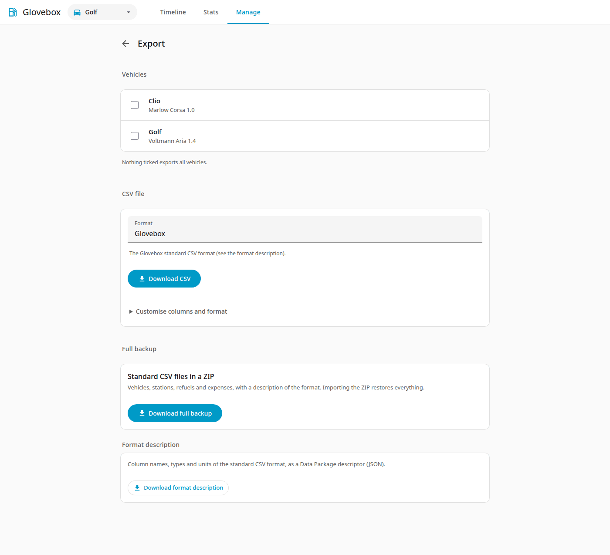

# Export and backup

Go to **Manage → Export**.

The page has two downloads, **CSV file** and **Full backup**, plus the format description.

| Export | Content |
|---|---|
| **CSV file** | Choose the **Format** and press **Download CSV**. **Glovebox** is the documented [standard format](standard-format.md) with all refuellings and expenses in one file. **Fuelly (metric)** gives refuellings only, one CSV per vehicle (zipped if more than one has records; a vehicle without refuellings gets no file). Expenses are left out and the station goes into the `tags` column. Your own saved presets that can export appear in the list too. |
| **Customise columns and format** | Under the format: pick the columns and their headers, the delimiter, the decimal separator, the date pattern and the units, then download, or press **Save preset** to reuse the layout (and to import files in that layout). |
| **Download full backup** | A ZIP with `records.csv`, `vehicles.csv`, `stations.csv` and `datapackage.json`. Everything, including stations without refuellings. |

Tick vehicles to export only those; with none ticked, all vehicles are exported. **Download format description** gives the description of the standard format as a Data Package descriptor (JSON).

If two vehicles share a name (an archived one and an active one), the archived one is written as `Name (archived)` so that the files stay unambiguous. The page tells you when this happens.

## Backup and restore

The full backup is your portable backup.

To restore: start Glovebox on an empty data folder, then import the ZIP on the Import page (**Manage → Import**). It goes straight to the preview. Vehicles with their details, stations, refuellings and expenses come back as they were, including which price figure was derived and where each record came from.

The same ZIP, without `datapackage.json`, is also a normal import with vehicle and station details; see [Import](import.md).

For the add-on, `/data` is also included in normal Home Assistant backups.

!!! tip
    Make a backup now and then and keep the file outside Home Assistant. It does not depend on the add-on or on any one install.
