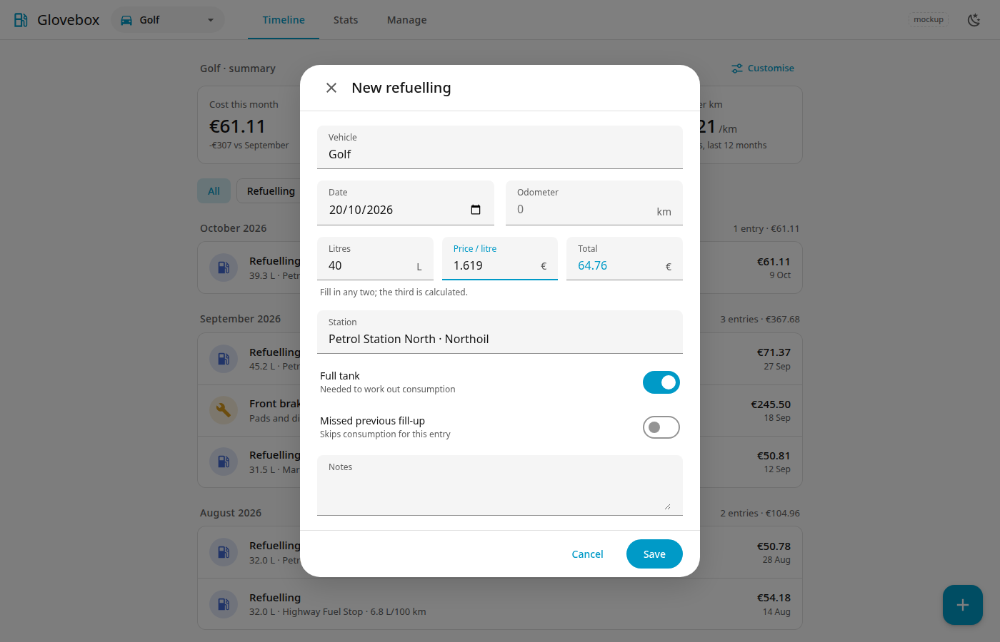

# First steps

## 1. Add a vehicle

Go to **Manage → Vehicles** and add your car. Only the name is essential. Make, model, plate, fuel type and initial odometer are optional.

## 2. Add a refuelling

Tap the **+** button and choose **Refuelling**.

Fill in the vehicle, date and odometer (km). Then enter the fuel figures.

### Any two of litres, price per litre, total

Enter **any two** of *litres*, *price per litre* and *total*. Glovebox calculates the third and remembers which one it derived.

Example: 40.00 L and a total of 60.00 gives a price of 1.500 per litre.

If you enter all three and the total differs from litres × price by more than 1 %, Glovebox warns you but still lets you save.

The station is optional. Pick an existing one or choose **New station** to create it on the spot (name, and optionally a brand).

### Full tank

Leave **Full tank** on when you filled the tank to the top. Turn it off for a partial fill.

Consumption is measured **from one full tank to the next**, so Glovebox needs to know which fills were full. If you mark a partial fill as full, the consumption numbers will be wrong.

### Missed fill-up

Turn on **Missed previous fill-up** when you forgot to record the fill before this one. Without that fill, the fuel used since the last full tank is not known, so Glovebox leaves that stretch out of the consumption figures. It shows **n/a** for it.

## 3. Check the result

After the second full tank, the [Timeline](timeline.md) shows your first consumption value.

!!! note
    Glovebox warns if the odometer is lower than that of an earlier record (or higher than that of a later one). Check the number, but you can still save.
