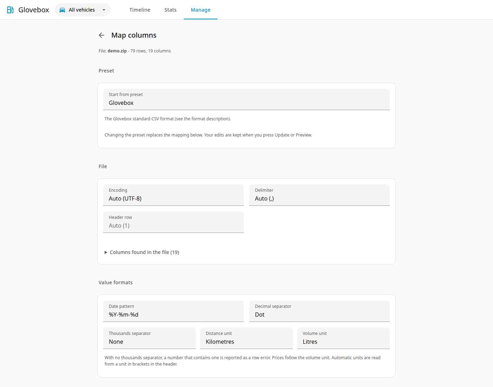
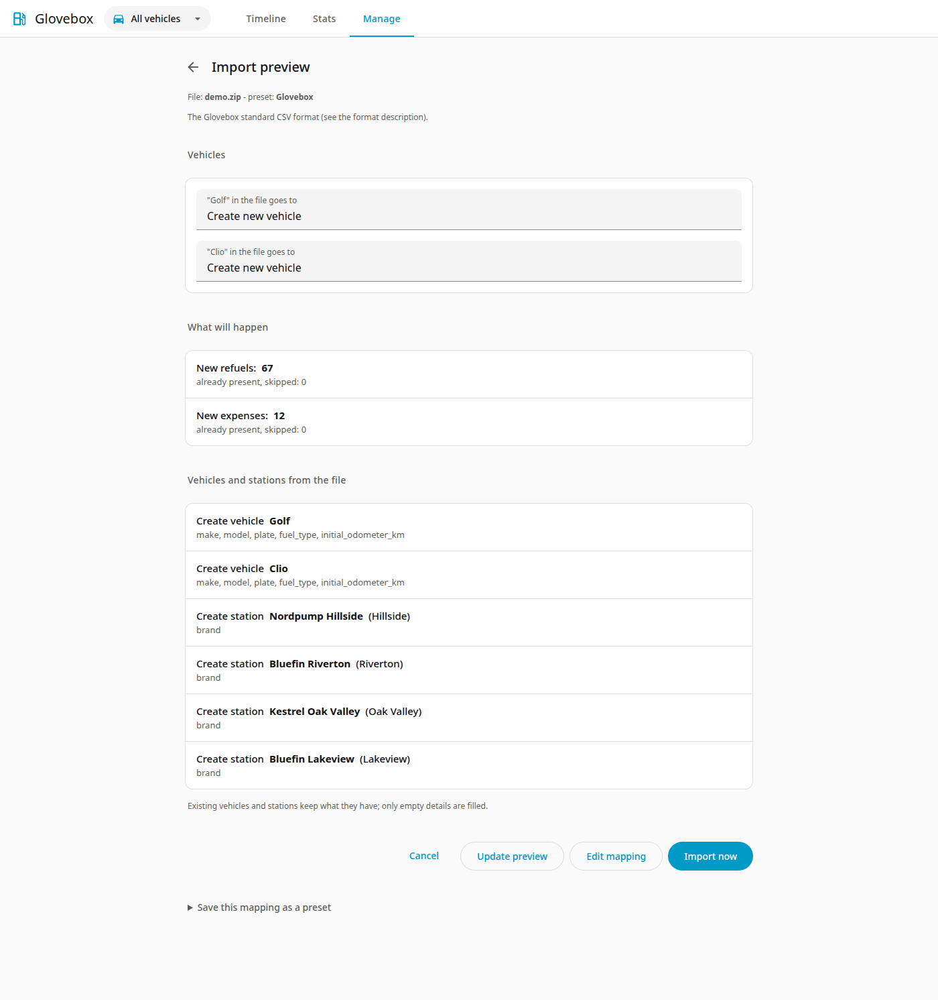
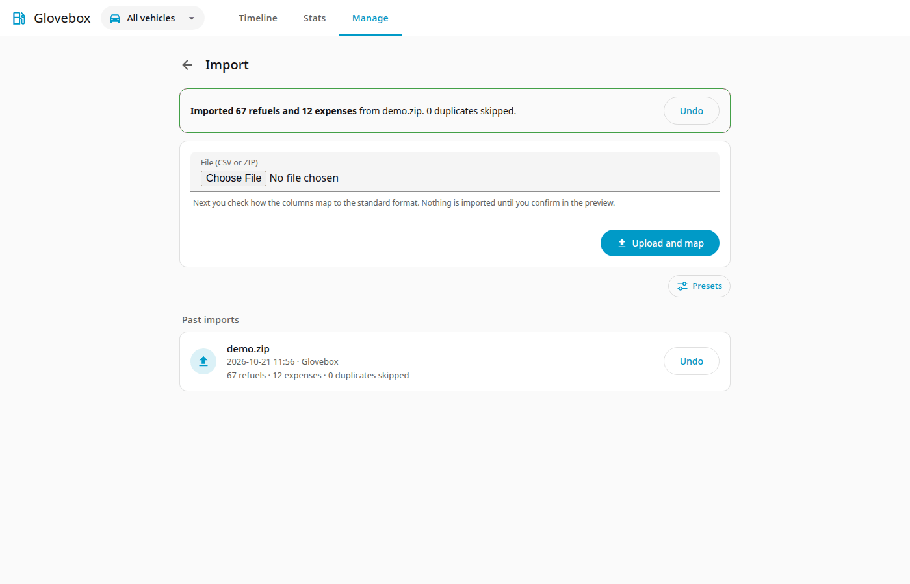
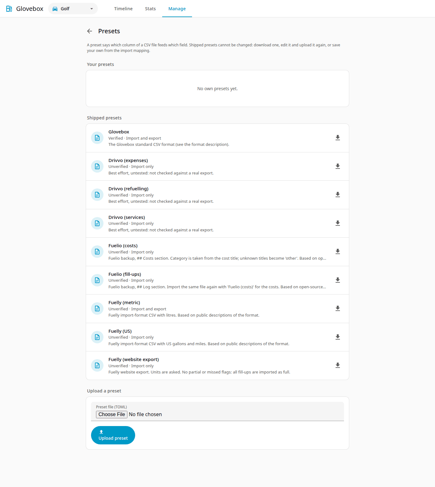

# Import

Go to **Manage → Import**.

Every import works the same way: a **preset** says which column of your file feeds which Glovebox field and how dates, numbers and units are written. Glovebox ships presets for several apps and for its own [standard CSV format](standard-format.md). You can adjust a preset for a single import and save the result as your own preset. See [Presets](presets.md) for the list and for every key of the preset file.

## Steps

1. **Upload**: choose a CSV file, or a ZIP of CSV files, and press **Upload and map**. Glovebox reads it and selects the best-fitting preset. It changes nothing yet.
2. **Map columns.** (Screenshot above.) Check the preset, the file settings (encoding, delimiter, header row, section) and the value formats (date pattern, decimal and thousands separators, units). Each Glovebox field takes a column of your file, a constant value, or nothing. Rarely used fields are under **More fields**. A file that no preset fits starts as a custom mapping; the required fields (`type`, `date`, and `odometer_km` for refuels, `total` and `title` for expenses) must be mapped before you can go on.
3. **Preview.** (Screenshot below.) It shows the preset and its note, record counts, the vehicles found, duplicates, rows that are left out and why, and warnings. Nothing is written yet.
4. **Answer questions** if there are any (see below), then press **Import now**. All records are added together as one **import batch**. The Import page then shows how many were added, with an **Undo** button. If every row is already present, the preview says so and offers no **Import now**; no empty batch is created.

Standard files and full backups: a file in the standard format picks the **Glovebox** preset; a full backup (a ZIP with a `datapackage.json`) goes straight to the preview.

## Supported layouts

| Preset | File | Status |
|---|---|---|
| Glovebox | The standard CSV format, or a full backup ZIP | Verified |
| Fuelly (metric), (US), (website export) | Fuelly import-format and website export CSV | Unverified: based on public descriptions |
| Fuelio (fill-ups), (costs) | Fuelio backup CSV, one section per preset | Unverified: based on open-source parsers |
| Drivvo (refuelling), (services), (expenses) | Drivvo CSV | **Best effort, untested** |

!!! warning "Unverified and untested presets"
    These mappings were not checked against a real export. If a file is not recognised or a value looks wrong, correct the mapping in the editor and save it as your own preset. Rows that cannot be read are listed with their line number and left out; the rest can still be imported.

### Fuelio backups have two sections

A Fuelio file holds fill-ups (`## Log`) and costs (`## Costs`). Import it once with **Fuelio (fill-ups)**, which is selected automatically, and once more with **Fuelio (costs)**. After the first import the page offers the other sections. Fuelio files carry no vehicle name, so you choose the vehicle.

## Vehicles and stations in the file

A ZIP can hold `vehicles.csv` and/or `stations.csv` next to the records, with or without a `datapackage.json` (see [Optional tables](standard-format.md#optional-tables-vehicles-and-stations)). The preview then lists what it will do:

- vehicles and stations that do not exist are **created** with the details in the file;
- vehicles (matched by name) and stations (matched by name and location) that exist are only **filled**: empty details are completed and nothing you entered is overwritten.

## Questions you may be asked

- **Vehicle**: the vehicle names of the file can be mapped to an existing vehicle or to a new one. A file without vehicle names asks which vehicle to use. A ZIP of several CSVs uses each file name as the vehicle name.
- **Dates**: if every date fits both day-first and month-first (like `03/04/2024`), you choose the order.
- **Units**: if the file does not say whether it uses miles and gallons or km and litres, you choose. Everything is stored in km and litres.

## Save a mapping as a preset

Under the preview, **Save this mapping as a preset** stores it under a name you choose. Next time a file with the same columns is uploaded, your preset is selected. Shipped presets are never changed: editing one and saving creates your own copy. Presets can be downloaded, uploaded and deleted on the **Presets** page (**Manage → Presets**, or the **Presets** button on the Import page).

## Good to know

- **Re-importing is safe.** Records matching an existing one (same vehicle, date, odometer and litres for refuellings; same vehicle, date, category and amount for expenses) are skipped and counted.
- **Undo.** Every import appears in the batch list and can be undone. That deletes the records it added, and the stations only that import created. Details filled into existing vehicles and stations are not taken back.
- **Brands** are never guessed. A brand is set only when the file gives one and the station is created. Set them under [Gas stations](stations.md).
- **Numbers** are read strictly: a thousands separator that the mapping does not expect makes that row an error instead of silently changing the value.
- **Old native exports** (from version 0.1) cannot be imported. Make a new full backup after upgrading.
