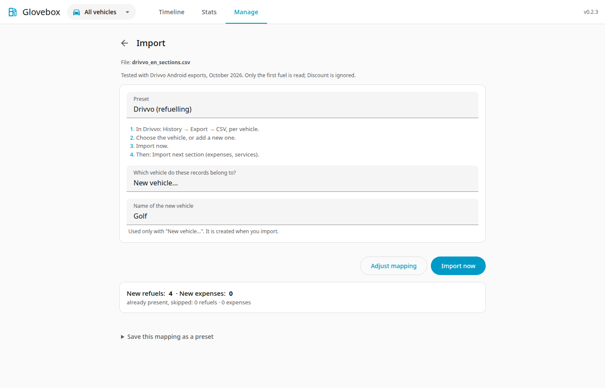

# Import

Go to **Manage → Import**.

Every import works the same way: a **preset** says which column of your file feeds which Glovebox field and how dates, numbers and units are written. Glovebox ships presets for several apps and for its own [standard CSV format](standard-format.md). You can adjust a preset for a single import and save the result as your own preset. See [Presets](presets.md) for the list and for every key of the preset file.

## Steps

1. **Upload**: choose a CSV file, or a ZIP of CSV files, and press **Upload**. Glovebox reads it and selects the best-fitting preset. It changes nothing yet.
2. **Review.** (Screenshot below.) You land here for any file that a preset fits. It shows the preset (pick another from the select; its short **steps** are listed below it), the vehicle question, and what will happen. For a file without vehicle names, choose the vehicle: an existing one, or **New vehicle...** and a name. The new vehicle is created when you import (undoing the import keeps it). Record counts, duplicates, rows that are left out and warnings are on this page. Changing the preset, the vehicle or an answer updates it at once. Nothing is written yet.
3. **Import now.** Answer the questions if there are any (see below), then press **Import now**. All records are added together as one **import batch**. The Import page then shows how many were added, with an **Undo** button. If every row is already present, the review says so and offers no **Import now**; no empty batch is created.
4. **Adjust mapping** (only when needed). If the review looks wrong, press **Adjust mapping**. A file that no preset fits, or that a preset reads with errors, opens this page directly. Each Glovebox field shows a plain label, its standard key (for example `odometer_km`) in small type, and the column of your file that feeds it, a constant value, or nothing. Options are folded under each field, and fields that are not mapped under **Fields not mapped**. The **File** settings (encoding, delimiter, header row, section) and the **Value formats** (date pattern, decimal and thousands separators, units) are folded into one line each; tap to open them. The required fields (`type`, `date`, and `odometer_km` for refuels, `total` and `title` for expenses) must be mapped. **Back to review** (at the top and at the bottom) returns to the review.

Standard files and full backups: a file in the standard format picks the **Glovebox** preset; a full backup (a ZIP with a `datapackage.json`) goes straight to the review.

## Supported layouts

| Preset | File | Status |
|---|---|---|
| Glovebox | The standard CSV format, or a full backup ZIP | Verified |
| Drivvo (refuelling), (expenses), (services) | Drivvo Android app CSV (History), one section per preset | Verified with real exports |
| Fuelly (metric), (US), (website export) | Fuelly import-format and website export CSV | **Never tested** against a real export: based on public descriptions |
| Fuelio (fill-ups), (costs) | Fuelio backup CSV, one section per preset | **Never tested** against a real export: based on open-source parsers |

!!! warning "Presets never tested against a real export"
    These mappings were not checked against a real export. If a file is not recognised or a value looks wrong, correct the mapping in the editor and save it as your own preset. Rows that cannot be read are listed with their line number and left out; the rest can still be imported.

### Files with several sections (Drivvo, Fuelio)

Some apps write several tables into one file, each after a section line. Glovebox keeps the file after you import one section: the result page says which sections are left and offers **Import next section: ...**. It opens the review for that section with the right preset and the vehicle you used before, so you only check and press **Import now**. Records already imported are skipped. These files carry no vehicle name, so choose the vehicle (or a new one) once, in the review of the first section.

- **Drivvo**: in the Android app open **History** with one vehicle selected and export CSV. The file holds `##Refuelling`, `##Expense` and `##Service`; Glovebox picks **Drivvo (refuelling)** first, then offers **Drivvo (expenses)** and **Drivvo (services)**. Drivvo writes one service row per item, so a service visit becomes several maintenance expenses on the same day. Items without a price are not expenses: their names are added to the note of the first priced item of the same visit (same date and odometer) as `Also: Oil filter, Air filter`; a free item with no priced item in its visit is skipped and counted. Expense types Glovebox does not know (for example ones you created yourself) become *other*: add them to the category map in the mapping step and save your own preset. The web app's export holds the same records but is not covered by a shipped preset; use the phone export.
- **Fuelio**: the backup holds fill-ups (`## Log`) and costs (`## Costs`); import it with **Fuelio (fill-ups)** and then **Fuelio (costs)**.

If you leave before the last section, the stored file is kept for 24 hours; after that, upload the file again.

## Vehicles and stations in the file

A ZIP can hold `vehicles.csv` and/or `stations.csv` next to the records, with or without a `datapackage.json` (see [Optional tables](standard-format.md#optional-tables-vehicles-and-stations)). The preview then lists what it will do:

- vehicles and stations that do not exist are **created** with the details in the file;
- vehicles (matched by name) and stations (matched by name and location) that exist are only **filled**: empty details are completed and nothing you entered is overwritten.

## Questions you may be asked

- **Vehicle**: the vehicle names of the file can be mapped to an existing vehicle or to a new one. A file without vehicle names asks which vehicle to use: an existing one, or **New vehicle...** with a name that no active vehicle has. A ZIP of several CSVs uses each file name as the vehicle name.
- **Dates**: if every date fits both day-first and month-first (like `03/04/2024`), you choose the order.
- **Units**: if the file does not say whether it uses miles and gallons or km and litres, you choose. Everything is stored in km and litres.

## Save a mapping as a preset

Under the preview, **Save this mapping as a preset** stores it under a name you choose. Next time a file with the same columns is uploaded, your preset is selected. Shipped presets are never changed: editing one and saving creates your own copy. Presets can be opened (to read the full note and steps), downloaded, uploaded and deleted on the **Presets** page, where you can also edit the note of your own presets. Shipped presets are always locked; **Duplicate** gives you an editable copy. Your own presets have a **Lock** switch: a locked preset cannot be edited or deleted until you unlock it (**Manage → Presets**, or the **Presets** button on the Import page).

## Good to know

- **Re-importing is safe.** Records matching an existing one (same vehicle, date, odometer and litres for refuellings; same vehicle, date, category and amount for expenses) are skipped and counted. Equal expenses within one file (two items of the same price on one day) are all kept; on a re-import each one is matched to one existing record.
- **Undo.** Every import appears in the batch list and can be undone. That deletes the records it added, and the stations only that import created. Details filled into existing vehicles and stations are not taken back.
- **Brands** are never guessed. A brand is set only when the file gives one and the station is created. Set them under [Gas stations](stations.md).
- **Numbers** are read strictly: a thousands separator that the mapping does not expect makes that row an error instead of silently changing the value.
- **Old native exports** (from version 0.1) cannot be imported. Make a new full backup after upgrading.
