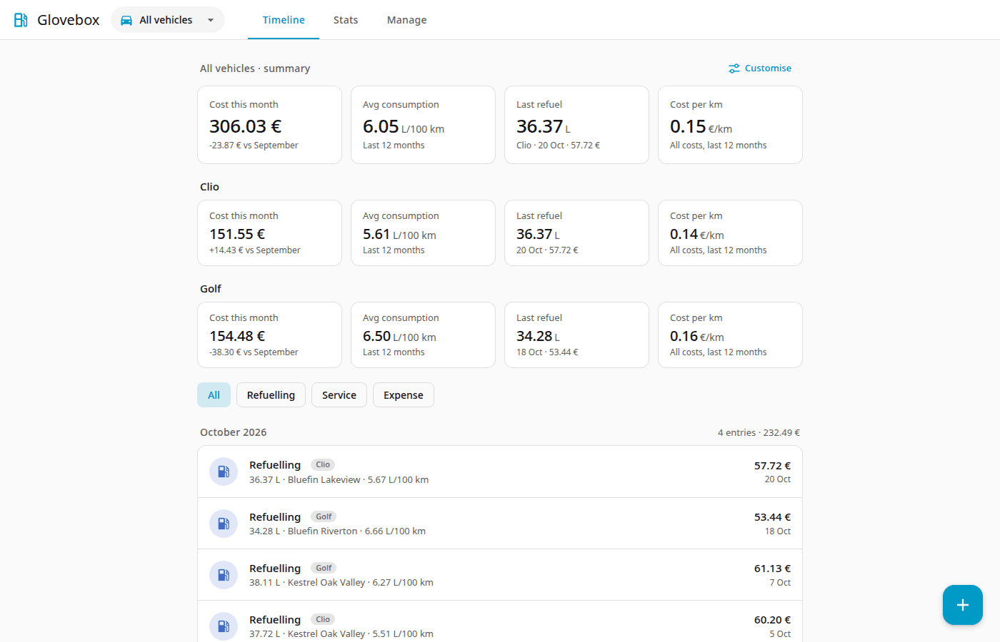
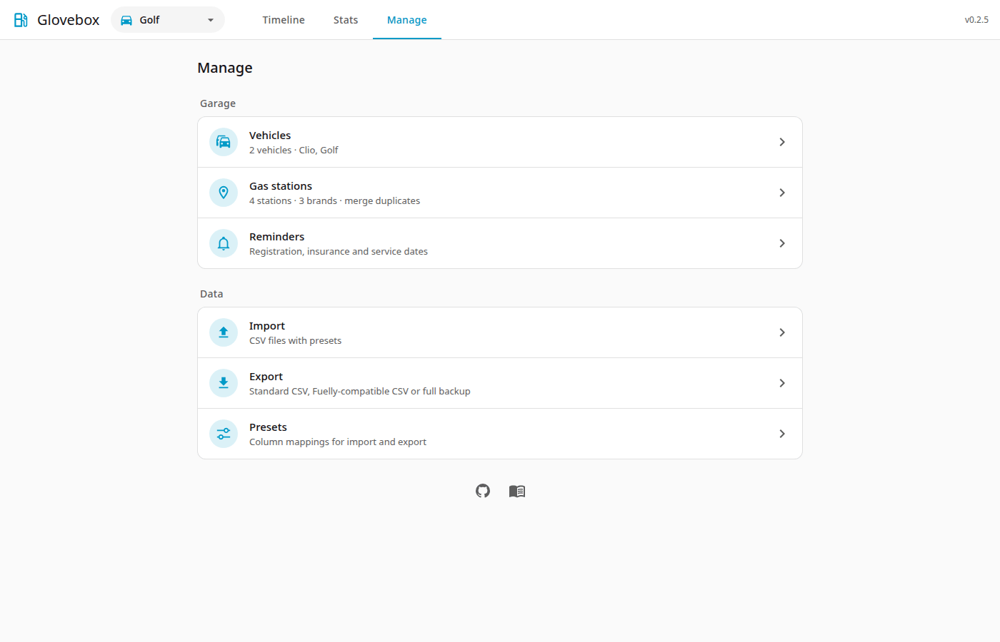
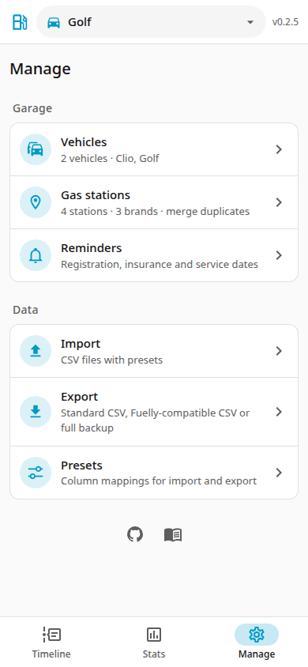

# Overview

Glovebox is a small web app for the running costs of your cars. It looks like part of Home Assistant when used as an add-on, and works on phones and desktops.

## What it does

- Records **refuellings**, **services** and other **expenses** (insurance, registration, parking and so on) for any number of vehicles.
- Works out **fuel consumption** between full tanks, **cost per km**, monthly costs and **price comparisons** between gas stations and brands.
- **Imports** history from CSV files with presets (Fuelly, Fuelio, Drivvo or your own mapping), and **exports** the standard CSV, a Fuelly-compatible CSV, a custom CSV or a full backup.
- Offers a read-only **stats API** for Home Assistant sensors.

## What it does not do

No receipts or photos, no electric charging records, no currency conversion. Values are stored in km and litres (imports convert miles and gallons).

## Screen layout

The top bar has the vehicle dropdown and three tabs: **Timeline**, **Stats** and **Manage**. On phones the tabs move to a bottom bar. The **+** button on the Timeline adds a record.

**Manage** is the home of everything else: Vehicles, Gas stations, Import, Export and Presets.

{ width="260" }

Choose a vehicle in the dropdown, or **All vehicles** to see everything together. Glovebox remembers your choice.
