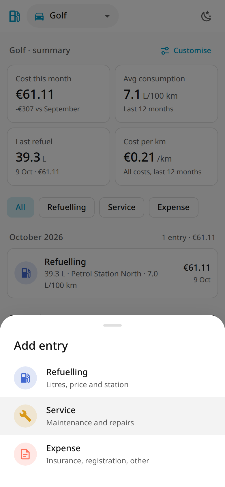
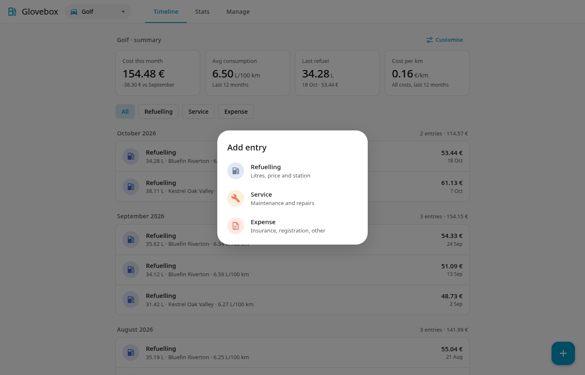
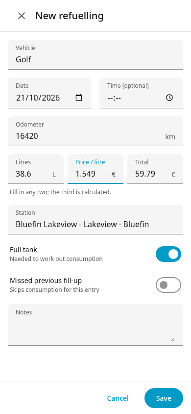

# Adding and editing records

Tap **+** on the Timeline and choose the record type (**Refuelling**, **Service**, **Expense** or **Reminder**; see [Reminders](reminders.md)). Every form has a **Vehicle** dropdown. It starts with the selected vehicle, or with the last specific vehicle when *All vehicles* is selected.

{ width="260" }

To edit or delete a record, open it from the Timeline.

## Refuelling

**Refuelling** opens the quick page, made for the pump. It is also available as `/quick` when you run Glovebox standalone.

- **Vehicle:** a choice at the top, shown only when you have more than one vehicle. It starts with the selected vehicle, else the last one used.
- **Odometer** comes first and has the number keypad. Under it you see the last reading and, as you type, how far you have driven since then (red when the number is lower than the last one).
- **Litres** and **Total** are the big fields; **Price / litre** is calculated, or type it and one of the others is calculated instead.
- **Station:** chips with the last station used with this vehicle and its two most frequent ones, preselected the last one. **Other** shows the normal station list, including *New station…*.
- **Full tank** is on. The date chip says *Today*; tap it to change the day. **More** adds *Missed previous fill-up* and notes. The time is the current time.
- **Save refuelling** is greyed out until odometer, litres and total are filled.

After saving you are back on the Timeline, where a bar at the bottom shows the litres, the total and the consumption of this tank (when it can be worked out), with **Undo**. Undo deletes the refuelling you just saved. Tap the entry later to edit it with all fields.

See [First steps](first-steps.md#2-add-a-refuelling). The full form (all fields, used for editing) fills the screen on a phone:

{ width="260" }

 Fields: vehicle, date, odometer, any two of litres / price per litre / total, station, full tank, missed previous fill-up, notes.

## Service

**Service** opens a quick page too (`/quick-service`): vehicle choice (only with several vehicles), **What was done** with chips (the fixed *Regular service*, then the titles you used before with this vehicle, at most four in all), a big **Amount**, and the **Odometer**. The field starts empty and shows the last recorded reading as a grey suggestion, with the hint *Last: … km on …*. Leave it empty and that reading is saved as an estimate (marked with ≈, with a warning on the Timeline); type the real one if you know it. The full add form behaves the same. The date chip says *Today*; **More** adds notes. Saving returns to the Timeline with *Service saved* and **Undo**. Editing an entry opens the full form below.

For maintenance: oil change, tyres, repairs. Fields: vehicle, date, odometer (optional), title (for example "Oil and filter change"), amount, notes. It is stored in the *maintenance* category.

## Expense

**Expense** opens the quick page `/quick-expense`: choose the type (insurance, registration, other), then the title (chips of the titles used before for that type), the amount (full price paid) and the odometer as for a service. **More** adds the coverage dates (both or none) and notes. Saving shows *Expense saved* with **Undo**.

For everything else. Choose a type with the **Type** switch:

- **Insurance**
- **Registration**
- **Other** (parking, tolls, car wash and so on; use the title for the detail)

Fields: vehicle, date, title (required), amount, optional odometer, optional coverage dates, notes.

### Coverage dates

Insurance and registration usually cover a period, not just the payment day. Enter **Coverage start** and **Coverage end** to say which period the payment covers.

- Set both dates or neither. The end must not be before the start. Both days are included.
- The amount is always the full price you paid. Coverage dates only change how [Statistics](statistics.md#spread-or-as-paid) divides the cost over months.
- Coverage is allowed on any expense.

### Reminders from an expense

Open an expense and tap **Remind me** to make a [reminder](reminders.md) for its renewal. The due date is the coverage end, or the expense date plus one year when there is no coverage. On the add-expense forms, the switch **Remind me before it runs out** does the same when you save.

## Vehicles

In **More details** of the vehicle form, the insurance and registration *valid until* dates have a switch **Remind me before it ends** with a **Notify** field in days. The reminder moves when you change the date and is deleted when you clear it. Deleting a vehicle asks for confirmation and says how many records and reminders go with it.
