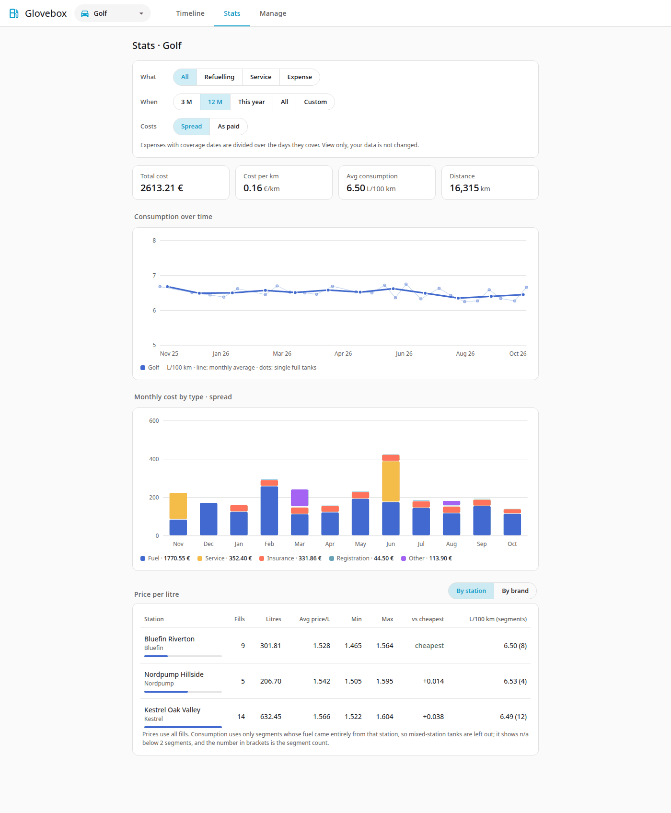
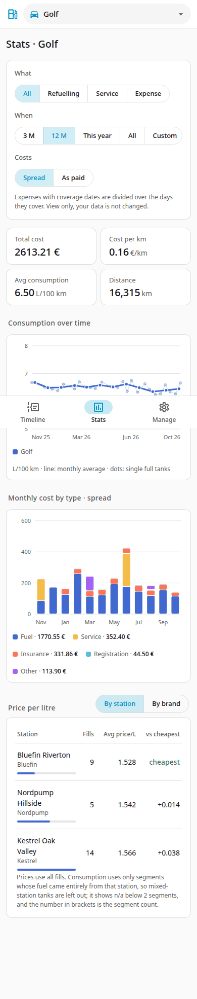

# Statistics

Open the **Stats** tab. Everything follows the vehicle chosen in the top dropdown.

## Filters

- **What**: All, Refuelling, Service or Expense.
- **When**: **3 M**, **12 M**, **This year**, **All**, or **Custom** (a from and to date).
- **Refine**: shown for Refuelling (a single station or brand) and Expense (an expense type).
- **Costs**: **Spread** or **As paid** (see below). Shown when expenses are included.

The summary numbers, charts and tables all update together. The page shows total cost, cost per km, average consumption and distance, then the consumption chart, the monthly cost chart and the price table.

On phones everything is in one column; scroll down to see the charts.

{ width="260" }

## How consumption is calculated

Glovebox measures consumption **between full tanks**.

For each full fill, it looks back to the previous full fill:

- **Distance** = odometer difference between the two full fills.
- **Fuel** = litres of every fill after the first full fill, up to and including the second. Partial fills in between count. The litres of the first full fill do not.
- **Consumption** = fuel ÷ distance × 100 (L/100 km).

Example: full at 1000 km, partial 10 L at 1200 km, full 30 L at 1600 km. Fuel = 10 + 30 = 40 L, distance = 600 km, so 40 ÷ 600 × 100 = **6.67 L/100 km**.

A stretch shows **n/a** and is left out of averages when:

- a fill in it is marked *missed previous fill-up*,
- there is no earlier full fill (so a vehicle's first fill never has a value), or
- the distance is zero or negative.

Averages are **weighted by distance**: total fuel ÷ total distance. They are not the mean of the individual values. For (20 L, 200 km) and (60 L, 1000 km) the average is 80 ÷ 1200 × 100 = 6.67, not 8.0.

Each value belongs to the date of the fill that closes the stretch.

## Cost per km

Total cost in the period (fuel plus expenses) divided by the distance driven. Distance is the highest minus the lowest odometer reading among the records in the period, including expenses that have an odometer.

Example: 300 fuel + 200 maintenance over 10 000 to 15 000 km is 500 ÷ 5000 = 0.10 per km.

## Spread or As paid

This switch decides how expenses with coverage dates appear in the monthly cost chart and in cost per km. It changes only the view. Your records stay as entered.

- **Spread** (default): the cost is divided over the days it covers, and each month gets its share.
- **As paid**: the full amount counts in the month it was paid.

Fuel is never spread. Expenses without coverage dates are always counted on their date.

**Worked example.** Insurance of 365.00 paid on 1 March 2026, covering 1 March 2026 to 28 February 2027 (365 days):

| Month | Spread | As paid |
|---|---|---|
| March 2026 | 31.00 | 365.00 |
| April 2026 | 30.00 | 0 |
| ... | one share per month | 0 |
| February 2027 | 28.00 | 0 |

The twelve spread parts add up to exactly 365.00.

!!! tip
    Use *Spread* to compare months fairly. Use *As paid* to see when money actually left your account.

## Stations and brands

The price table compares **By station** or **By brand**: number of fill-ups, litre-weighted average price per litre, minimum and maximum, and how much more expensive each is than the cheapest.

Consumption per station or brand is only shown when it is trustworthy:

- Only stretches where **every fill came from that station or brand** are used. A stretch that mixes stations counts for neither.
- At least **2** such stretches are needed. With fewer, the value is **n/a**.
- The number of stretches used is shown next to the value.

Prices use all fill-ups, so they need no such condition. To get brand comparisons, [assign brands](stations.md) to your stations.
