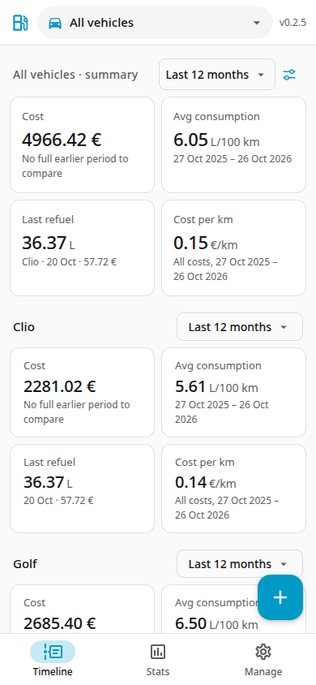
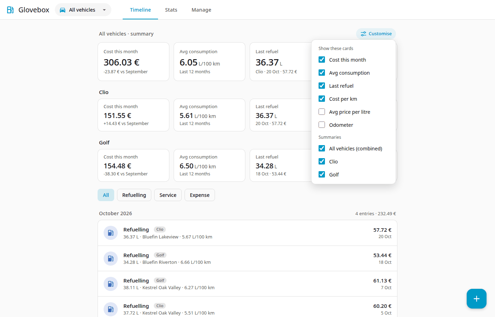
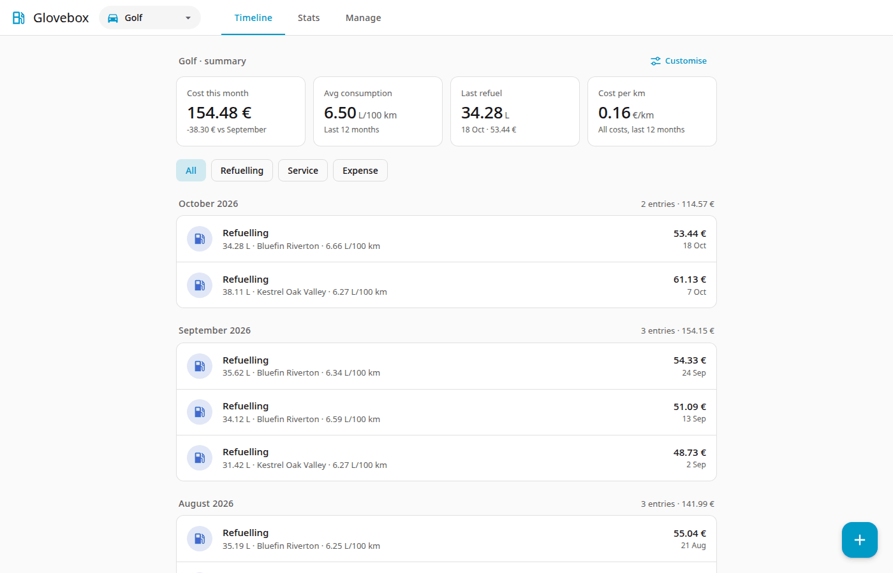

# Timeline

The Timeline lists all records, newest first, grouped by month. Each month shows its number of entries and total cost.

{ width="260" }

## Summary cards

At the top are summary cards for the selected vehicle:

| Card | Shows |
|---|---|
| Cost | Total cost in the period, compared with the earlier period |
| Avg consumption | L/100 km in the period |
| Last refuel | Litres, date and total of the latest fill |
| Cost per km | All costs divided by distance, in the period |
| Avg price per litre | Fuel cost divided by litres, in the period |
| Odometer | Latest reading |

The first four are shown by default. Last refuel and Odometer show the latest values and do not depend on the period.

### Period

The chip next to the summary title sets the period of the cards **Cost**, **Avg consumption**, **Cost per km** and **Avg price per litre**. Choose **This month**, **Last 30 days**, **This year**, **Last 12 months** (the default), **All time** or **Custom range** (enter From and To dates, then Apply). The hint under each card shows the date range.

The Cost card compares with an earlier period:

| Period | Compared with |
|---|---|
| This month | The same days of the previous month (1 to 10 October against 1 to 10 September) |
| This year | The same days of the previous year |
| Last 30 days, Last 12 months, Custom range | The period of equal length just before |
| All time | Nothing; the hint shows the date range |

The comparison is made only when your records reach back to the start of the earlier period (for All vehicles, the earliest record of any vehicle). Otherwise the hint says "No full earlier period to compare", so a partly covered period is never compared. A period without refuelling shows a dash and "No refuelling in period" for consumption, cost per km and price. In **This month** the card is titled "Cost this month".

Each vehicle remembers its own period, and the combined **All vehicles** summary has one of its own. A vehicle keeps its period whether you look at it alone or in the all-vehicles view. Glovebox stores the choice on the server, so it is the same on every device.

### Customising

Click **Customise** (the sliders icon on phones) next to the summary title and tick the cards you want. With **All vehicles** selected, the same popover also has a **Summaries** list to show or hide the combined summary and each vehicle's summary. Glovebox remembers your choices on the server, so they are the same on every device.

## Filters

Under the cards, the chips **All · Refuelling · Service · Expense** limit the list to one record type.

Click a record to edit or delete it.

## All vehicles

Choose **All vehicles** in the top dropdown to see every vehicle's records in one list. The summary then shows a combined card set and a summary for each vehicle. Each record shows which vehicle it belongs to.

The vehicle you pick is remembered. When you add a record while *All vehicles* is selected, the form starts with the last specific vehicle you used.
